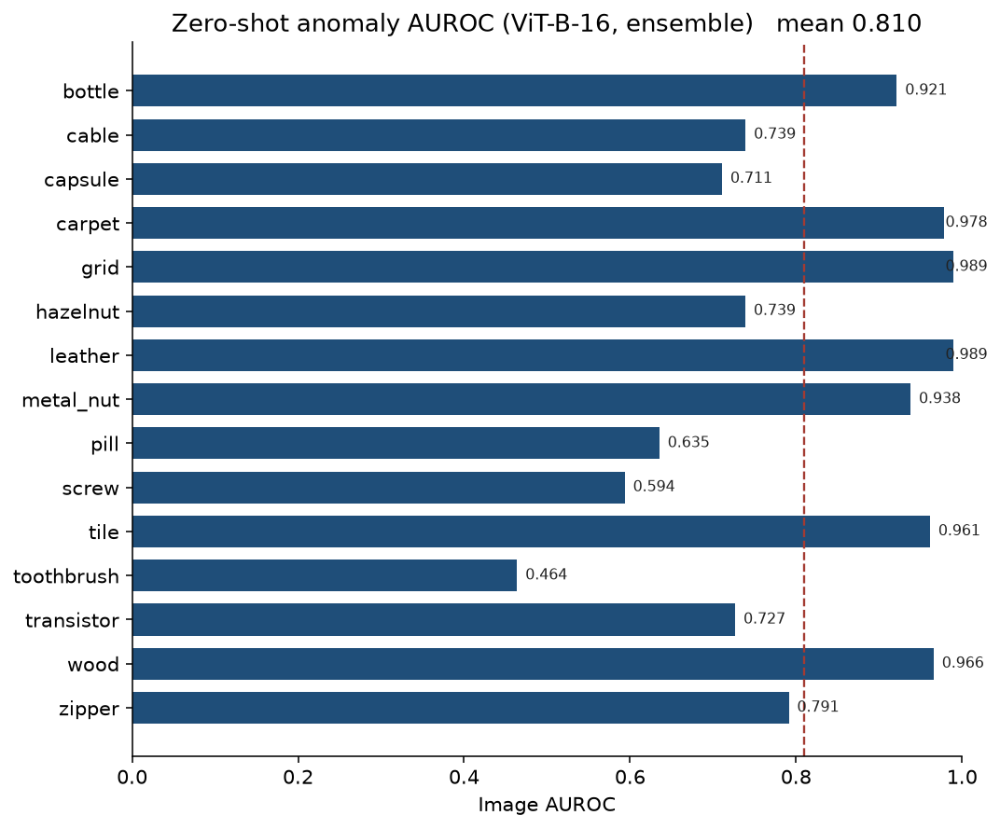
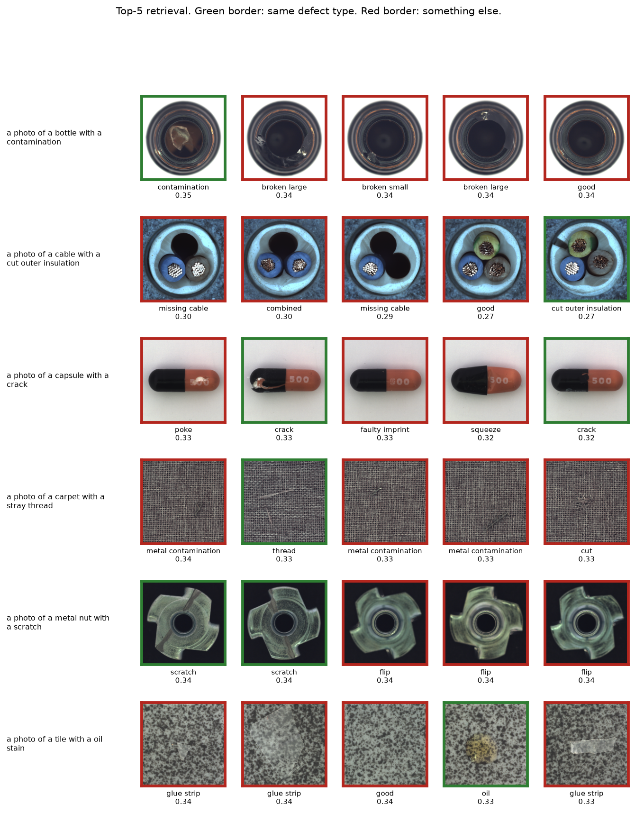
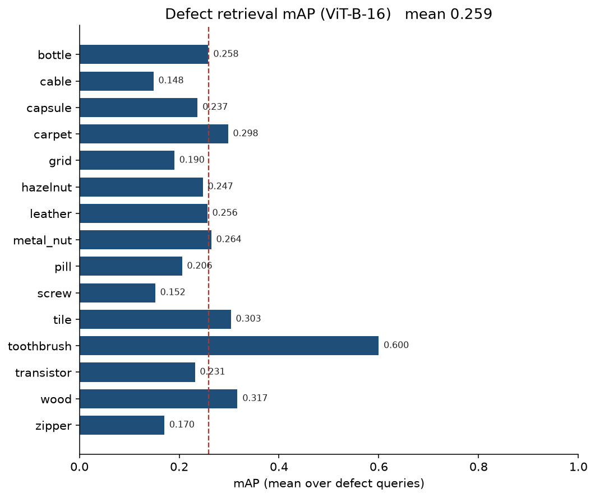
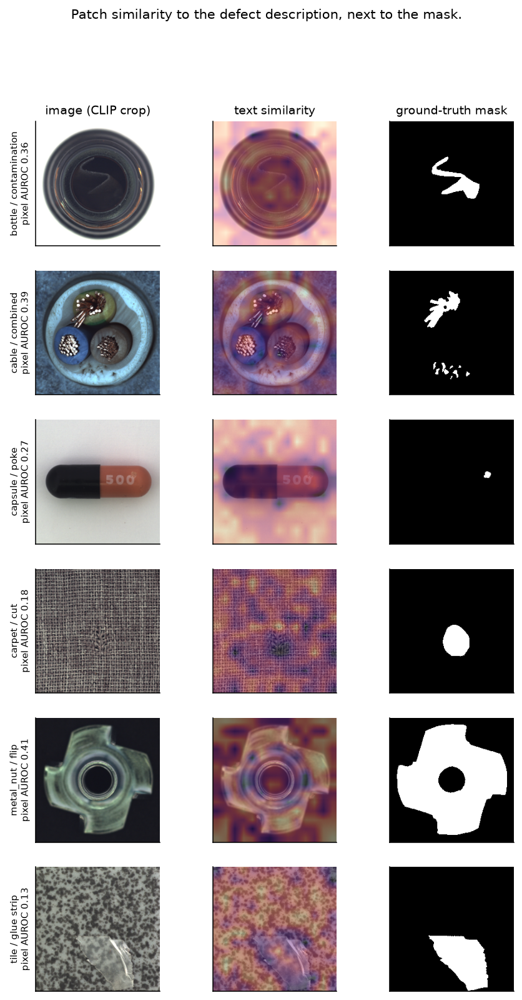
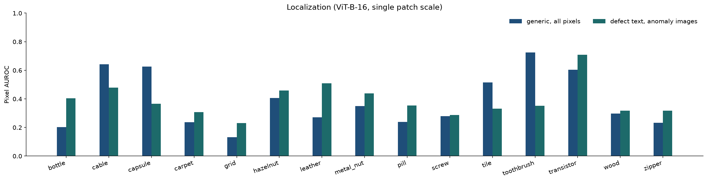
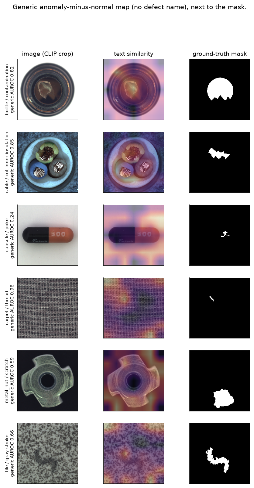
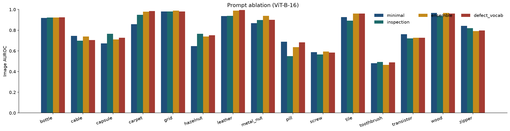
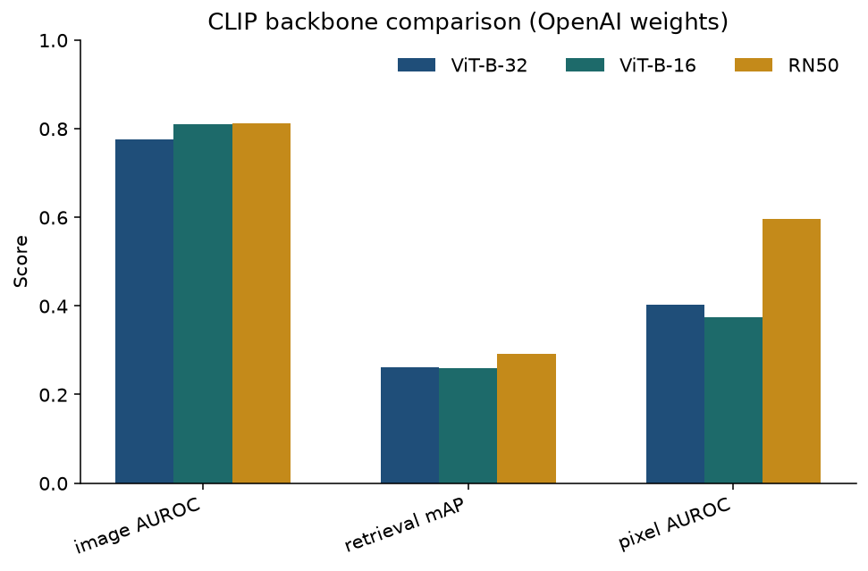
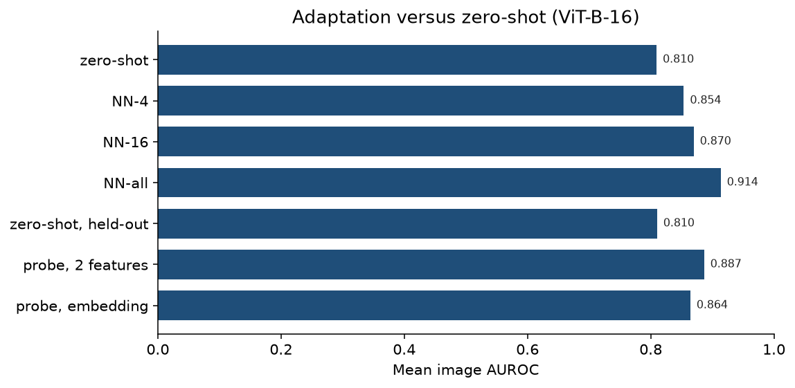

# Finding an industrial defect from a sentence

I wanted a small, reproducible baseline for the kind of model I want to work on: a vision-language model that can search an inspection line with text, and score an image as normal or defective without a labeled set of anomalies.

This repo runs a frozen OpenAI CLIP (through OpenCLIP) on [MVTec AD](https://www.mvtec.com/research-teaching/datasets/mvtec-ad). There are three tasks:

1. **Text-to-image retrieval.** A query such as "a scratch on the metal nut" ranks that category's test images. Relevance is the dataset's defect-folder label.
2. **Zero-shot anomaly classification.** A prompt ensemble in the style of WinCLIP (a normal state and a defect state, several templates, averaged text embeddings). The score is the cosine gap. I report image AUROC per category.
3. **Patch similarity maps.** The same text is compared to patch tokens, upsampled, and scored against the pixel masks.

The headline number, on the standard MVTec test split with seed 0, is a mean image AUROC of **0.810** for ViT-B-16. A memory of normal training images beats that. Naming the defect in a prompt barely moves image AUROC, and ViT patch tokens do not localize the mask. Details and the failures are below. Every number in this file was measured in this run. The JSON files in `results/` are the source.

## The problem

MVTec AD is 15 manufactured objects and textures, 5,354 images. Training images are all defect-free (3,629). The test split has 1,725 images: some good, some with a named defect (73 defect types in total). Pixel masks ship with the anomalous test images.

A classical anomaly detector learns what "normal" looks like from the training images of one product. That works, and the few-shot section below shows how far a CLIP embedding gets with only that. It does not let you ask for a scratch rather than a dent, and it has nothing to say about a product it has never seen. Text is the other prior: the model already knows words like "scratch", "crack", and "contamination". The question is how far that prior goes on industrial photos it was not trained on.

## Method

Images and prompts are encoded with OpenCLIP, OpenAI weights, 224 pixels. I force QuickGELU. OpenCLIP 4.x otherwise builds the ViT with plain GELU and warns that the checkpoint does not match; I checked that the pooled vector from the patch path matches `encode_image`.

**Anomaly score.** For each category I build two text prototypes. The normal prototype averages embeddings of sentences like "a photo of a flawless bottle" and "an industrial inspection photo of a bottle without defect". The anomaly prototype does the same with "damaged", "defective", "with a flaw", and so on. Six states and six templates, 36 prompts on each side. Image features and prototypes are L2-normalized. The score is cosine(image, anomaly) minus cosine(image, normal). With two prototypes a softmax is a monotone transform of that gap, so the AUROC would be identical. I report the gap.

**Retrieval.** The query for a defect type is four sentences ("a photo of a metal nut with a scratch", and close variants). The gallery is every test image of that category, including good images and the other defects. An image is relevant when its folder name matches the query. Recall@k is the fraction of relevant images that land in the top k, which stays low when a defect has dozens of photos and k is 5. Hit@k is 1 when at least one relevant image is in the top k. mAP is sklearn's average precision. Macro numbers average the 15 categories equally, so cable's eight defect types do not dominate toothbrush's one.

**Maps.** ViT patch tokens (class token removed) go through the same projection as the image embedding. For ResNet-50 I do not use the global attention pool for the map. I read out each cell of the last convolutional map with the pool's value and output projections, so the map stays local. A generic map is the anomaly-minus-normal gap at every patch. A defect-text map is cosine similarity to the sentence for that image's own defect name. That second map is what a user would type, and it is not a fair unsupervised score, because it uses the type name. Masks are resized with the same geometry as the CLIP crop. Every MVTec test image is square, so the center crop does not cut the frame. Scores are bilinearly upsampled to 224. I also max-pool window sizes 1, 2, and 3 on the token grid before upsampling.

This is WinCLIP-style prompting, not a reproduction of WinCLIP. I do not run a separate CLIP forward on every window. That is a lot of encodes on CPU, and it is the part of their method that actually localizes. The gap shows up in the maps.

## Results

Seed 0. Default model ViT-B-16, OpenAI weights. Image AUROC is the unweighted mean over 15 categories.

### Zero-shot classification

| Category | Image AUROC | Good test images | Anomalous test images |
| --- | ---: | ---: | ---: |
| bottle | 0.921 | 20 | 63 |
| cable | 0.739 | 58 | 92 |
| capsule | 0.711 | 23 | 109 |
| carpet | 0.978 | 28 | 89 |
| grid | 0.989 | 21 | 57 |
| hazelnut | 0.739 | 40 | 70 |
| leather | 0.989 | 32 | 92 |
| metal_nut | 0.938 | 22 | 93 |
| pill | 0.635 | 26 | 141 |
| screw | 0.594 | 41 | 119 |
| tile | 0.961 | 33 | 84 |
| toothbrush | 0.464 | 12 | 30 |
| transistor | 0.727 | 60 | 40 |
| wood | 0.966 | 19 | 60 |
| zipper | 0.791 | 32 | 119 |
| **mean** | **0.810** | | |

Textures (carpet, grid, leather, tile, wood) are easy for this prompt set. Small or ambiguous defects are not. Toothbrush is below chance: the defects are bent bristles, and "a damaged toothbrush" does not describe that well. Screw and pill are weak for the same kind of reason.



### Retrieval

73 defect queries. Macro mAP is **0.259** (micro, averaging queries rather than categories, is 0.232).

| | @1 | @5 | @10 |
| --- | ---: | ---: | ---: |
| Recall | 0.013 | 0.068 | 0.137 |
| Hit | 0.206 | 0.634 | 0.838 |

Hit@5 of 0.63 means that for about two thirds of defect types, at least one correct photo is in the top 5. Recall@5 of 0.07 means those five slots still miss most of the photos of that defect. Both are the right reading of a multi-image class. The grid below is the median-AP query in each of six categories I picked before looking at scores (bottle, cable, capsule, carpet, metal_nut, tile), not the queries that worked best.





Cosines sit in a narrow band around 0.33. Rankings still move, but the model is not very sure. Cable and screw are the weak categories. Toothbrush has a single defect type, so its mAP (0.600) is a much easier binary ranking and I would not quote it on its own.

### Localization

Pixel AUROC, ViT-B-16, mean over categories.

| Map | Pixels | Single patch | Windows 1+2+3 |
| --- | --- | ---: | ---: |
| Generic (no defect name) | all test pixels | 0.384 | 0.398 |
| Generic | anomalous images only | 0.374 | 0.384 |
| Defect-text query | anomalous images only | 0.390 | 0.455 |

Below 0.5 means defect pixels rank *lower* than the surrounding ones. I don't think this is a mask-alignment bug: the overlays track the object (the bottle mouth, the cable strands, the capsule body) and miss the small defect. Across 1,258 anomalous images, the median per-image defect-text AUROC is 0.281, and only 18% of images clear 0.5. Global self-attention mixes every patch with the whole object before the text comparison, so the token is a poor local descriptor. Window pooling helps the defect-text map (0.390 to 0.455) and does not fix it.

The panel is again a median image per category, not a highlight reel.







ResNet-50 is the exception on the generic map: **0.597** on anomalous images, and 0.613 if good images (empty masks) are included. Naming the defect does not help it. The defect-text map falls to 0.450. Window pooling moves the generic number to 0.612 and the defect-text number to 0.533. The panel below is the median image per category under that generic score, not a cherry-pick. The bottle contamination and the cut cable land on the mask. The capsule poke, which is a few pixels, does not. The map is still 7 by 7. Defect-text medians for the same backbone are in `assets/localization_rn50_examples.png` and look worse, in line with 0.450.

## What I added

Three experiments that are not just "run CLIP on MVTec". Same seed, same cached image features within a backbone.

### Prompt ablation

Same ViT-B-16 image features. Only the text changes.

| Prompt set | Mean image AUROC |
| --- | ---: |
| One sentence each ("flawless" vs "damaged") | 0.792 |
| Six states, inspection-photo template only | 0.793 |
| Full ensemble (main method) | 0.810 |
| Ensemble plus the category's defect names | 0.811 |

The ensemble is worth about two points over a single sentence. Telling the model the defect vocabulary (crack, scratch, and so on, with no image labels) adds almost nothing on top. Image-level CLIP already fires on a generic "damaged object" sentence. The per-category chart shows the gain is not uniform: tile and hazelnut move, toothbrush does not.



### Three CLIP backbones

OpenAI weights. Pixel AUROC here is the generic map on anomalous images, single scale.

| Backbone | Image AUROC | Retrieval mAP | Pixel AUROC |
| --- | ---: | ---: | ---: |
| ViT-B-32 | 0.776 | 0.262 | 0.402 |
| ViT-B-16 | 0.810 | 0.259 | 0.374 |
| RN50 | 0.812 | 0.292 | 0.597 |

ViT-B-16 wins the ViT image-level comparison and loses localization to the smaller ViT-B-32, which has a coarser but less mixed 7 by 7 grid. RN50 is the one I would actually ship for a map: similar image AUROC, better retrieval, and the only pixel number above chance. The readout is local. The ViT token is not.



### Few normal images, and a light probe

Still ViT-B-16. The nearest-neighbor scores use only defect-free training images: the anomaly score is 1 minus the cosine to the nearest of k of them. The 4-shot set is a prefix of the 16-shot set, one permutation per category, seed 0.

The probes are the part that sees anomaly labels. For each category I hold out one anomalous test image per defect type, plus 8 normal training images that are disjoint from the 16-shot support. A logistic regression is fit on that handful and scored on the remaining test images. `probe, 2 features` uses the zero-shot gap and the NN-16 distance (C=1). `probe, embedding` uses the 512-d CLIP vector with strong L2 regularization (C=0.01). The held-out zero-shot row is the text score on that same reduced test set, so it can be compared with the probes. The NN rows are on the full test set. The two zero-shot numbers match to 0.001, so the held-out split is not a softer test.

| Method | Anomaly labels | Mean image AUROC |
| --- | --- | ---: |
| Zero-shot ensemble | no | 0.810 |
| NN-4 | no | 0.854 |
| NN-16 | no | 0.870 |
| NN, all normal training images | no | 0.914 |
| Zero-shot, held-out test | no | 0.810 |
| Probe on (gap, NN-16) | yes, one image per defect | 0.887 |
| Probe on the CLIP embedding | yes, one image per defect | 0.864 |

Four normal photos already beat the text prior. The full normal set is the best number in the repo (0.914) and wins 10 of 15 categories outright. The 2-feature probe beats text on the shared split (0.887 vs 0.810) but does not beat the normal memory. The 512-d probe, with a dozen points, underperforms the 2-d one. For this dataset the useful adaptation is "remember normal", not "fit a classifier to a few defects".



## How to run

CPU is enough. A GPU will be used if you pass `--device cuda` or leave the default `--device auto`. The first call downloads OpenAI CLIP weights into the Hugging Face cache. They are not committed. Neither is MVTec.

```bash
python -m venv .venv
source .venv/bin/activate
pip install -r requirements.txt

python scripts/download_mvtec.py
python scripts/run_zeroshot.py          # image AUROC, assets/zeroshot_auroc_by_category.png
python scripts/run_retrieval.py         # Recall@k, mAP, retrieval grid
python scripts/run_localize.py          # pixel AUROC and the heatmap panel
python scripts/run_prompt_ablation.py
python scripts/run_backbone_comparison.py
python scripts/run_fewshot.py
```

`bash scripts/run_all.sh` runs those in order. Seed defaults to 0. Features are cached under `cache/` after the first encode, so reruns of the text ablations are cheap. `--categories bottle carpet` restricts a run. `--model RN50` or `--model ViT-B-32` switches the backbone. A second localization run that should not overwrite the ViT-B-16 files:

```bash
python scripts/run_localize.py --model RN50 --stem localization_rn50
```

The demo loads the test-split cache (and builds it if you have not run an experiment yet):

```bash
python app/demo.py
```

Retrieval ranks the category you pick. The second tab draws a patch map for one test image and the sentence you type. The zero-shot gap shown there is not a calibrated probability.

## Limits

I ran this on CPU, so I did not sweep large CLIP models (ViT-L/14, SigLIP, EVA) and I did not implement WinCLIP's per-window image forwards. The localization numbers are the consequence.

The official MVTec download is a form now, and the old direct links return 404. `scripts/download_mvtec.py` fetches a public copy of `mvtec_anomaly_detection.tar.xz` (5,264,982,680 bytes) and checks that all 15 category folders are there. After extraction I got the published count, 5,354 images. The dataset is CC BY-NC-SA 4.0 and is not in this repo. VisA is the other public inspection set I considered. Its official S3 archive is up, but the images are several thousand pixels on a side and the defect names live in multi-class masks rather than folders. I did not run it.

Toothbrush below 0.5, and ViT maps below 0.5, are real. I would rather show them than tune prompts until the mean looks like a paper.

## License

Code is MIT. See `LICENSE`. MVTec AD is covered by its own non-commercial license. CLIP weights stay in your local cache and follow the OpenAI / OpenCLIP terms.
